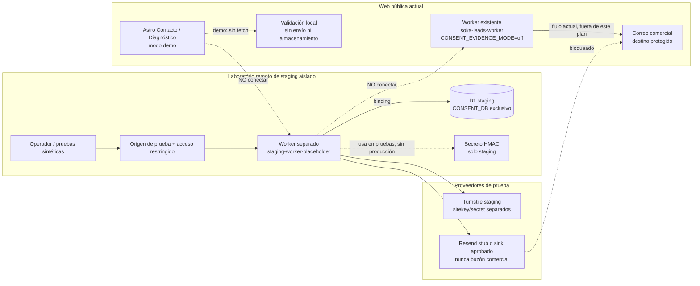

# Plan de D1 remoto aislado para staging

**Estado:** plan preparado; infraestructura remota **NO creada**.

**Fecha de revisión de límites y precios:** 2026-10-27.

**Alcance:** diseñar un laboratorio remoto aislado para probar la evidencia de consentimiento con datos sintéticos. Este documento no crea D1, no configura secretos, no modifica Workers desplegados, no cambia tráfico y no habilita formularios.

**Resultado obligatorio:** Contacto y Diagnóstico permanecen en modo demo y el tratamiento real de leads permanece en **NO-GO**.

## 1. Resumen ejecutivo

SokaTechnologies tiene un Worker existente llamado `soka-leads-worker`, pero su configuración versionada no declara un binding D1 remoto, no contiene `database_id` y mantiene `CONSENT_EVIDENCE_MODE = "off"`. El sitio Astro también conserva los formularios en modo demo salvo que se introduzca una configuración explícita de Worker, endpoint HTTPS válido y clave pública de Turnstile.

El entorno de staging propuesto debe ser un conjunto separado:

- Base D1 exclusiva para staging.
- Worker de pruebas con nombre, binding, variables, rate limiter y acceso independientes.
- Clave HMAC de staging que nunca se reutilice en producción.
- Datos sintéticos y origen de prueba restringido.
- Proveedor de correo simulado o sink de pruebas aprobado; nunca `info@sokatechnologies.com`.
- Sin ruta desde los formularios públicos actuales.

La creación de recursos, la configuración de secretos y cualquier despliegue requieren aprobaciones separadas. Un GO técnico del laboratorio no es autorización jurídica, operativa ni de producción.

## 2. Estado actual inventariado

### 2.1 Worker y tráfico

| Elemento | Estado comprobado en el repositorio | Protección para esta tarea |
|---|---|---|
| Worker existente | `worker/wrangler.toml` declara `name = "soka-leads-worker"`. | No usarlo como Worker de staging ni modificar su configuración. |
| Origen permitido | `https://prueba.sokatechnologies.com` en la configuración versionada. | No añadir orígenes de staging al Worker existente. |
| Consentimiento | `CONSENT_EVIDENCE_MODE = "off"`. | Conservar `off` por defecto. |
| D1 remoto | No existe sección `[[d1_databases]]` ni `database_id` en `worker/wrangler.toml`. | No añadir binding ni ID en esta tarea. |
| Rate limiting | Existe un binding `RATE_LIMITER` con namespace placeholder y límite de 5 por 60 segundos. | El staging debe usar otro namespace, creado solo con autorización. |
| Distribución de tráfico | El archivo no declara rutas, dominios ni distribución del Worker. | La ruta real debe verificarse de forma de solo lectura antes de cualquier alta; no se infiere del repositorio ni se cambia aquí. |
| Secretos | El repositorio no es fuente autorizada para valores de Turnstile, Resend o HMAC. | No consultar, copiar, rotar ni versionar secretos. |

La ausencia de rutas en el TOML no demuestra que el Worker no tenga tráfico asociado mediante la cuenta Cloudflare. El inventario futuro debe confirmar, sin modificar, cuenta, zona, rutas, deployments, ambientes y dominios. Si no se puede demostrar la separación, el paso es **NO-GO**.

### 2.2 Formularios Astro

`src/components/ContactForm.astro` calcula el modo en build:

- El proveedor por defecto es `demo`.
- Solo considera live una configuración que combine proveedor `worker`, endpoint HTTPS permitido y `PUBLIC_TURNSTILE_SITE_KEY`.
- En demo, la validación ocurre en el navegador y no se invoca el endpoint ni se almacenan datos.
- Contacto y Diagnóstico comparten el componente, pero tienen entradas separadas en el catálogo de autorizaciones.
- La página muestra la advertencia de no enviar contraseñas, tokens, llaves privadas ni datos sensibles.

La vista de Auditoría es un tratamiento separado: su vista previa es local y la integración server-side con Google PageSpeed no está habilitada públicamente. No forma parte del primer laboratorio de D1.

### 2.3 D1 local y runtime nativo

Las pruebas existentes cubren dos superficies distintas:

1. `docs/d1-local-operations.md` documenta SQLite persistente de Wrangler/D1 local en SSD, sin `database_id` remoto.
2. `docs/d1-native-runtime-tests.md` ejecuta el Worker dentro de `workerd` con el binding D1 nativo local y proveedores simulados.

Ambas superficies son laboratorios locales. No demuestran que una base remota, una ruta pública, los límites de cuenta, el proveedor de correo ni la distribución de tráfico estén autorizados para staging.

### 2.4 Dependencias del futuro modo `required`

El Worker necesitaría, como mínimo, un entorno separado con:

| Dependencia | Requisito de staging | Regla de aislamiento |
|---|---|---|
| `CONSENT_EVIDENCE_MODE` | `required` solo en el Worker de pruebas. | `off` sigue siendo el valor compartido y desplegado por defecto. |
| `CONSENT_DB` | Binding al D1 de staging. | No compartir el binding con producción. |
| `CONSENT_EVIDENCE_HMAC_KEY` | Secreto estable, sintético o exclusivamente de staging. | Nunca ponerlo en Git, logs, HTML o comandos visibles. |
| Turnstile | Sitekey y secret separados, asociados al origen de prueba. | Nunca usar credenciales de producción. |
| Resend | Stub controlado o proyecto/sink de pruebas aprobado. | No usar API key de producción ni enviar al buzón comercial. |
| `RATE_LIMITER` | Namespace separado y límites bajos. | No consumir ni modificar el namespace del Worker existente. |
| `ALLOWED_ORIGINS` | Únicamente el origen de prueba aprobado. | No incluir el origen público actual por comodidad. |

## 3. Arquitectura propuesta

El siguiente diagrama es conceptual y no es una configuración ejecutable. Las rutas punteadas terminan en un bloqueo: el laboratorio no tiene permiso para llegar al Worker actual ni al buzón comercial.



Controles de diseño:

- **Límite de cuenta:** el Worker y D1 se crean en la cuenta y ambiente autorizados, con nombres inequívocos de staging.
- **Límite de tráfico:** no se añade ruta pública ni se cambia la distribución del Worker existente. **Un Worker recién desplegado puede quedar accesible por `workers.dev` aunque no se configure DNS ni una ruta personalizada**. El futuro despliegue debe deshabilitar `workers.dev` y las URL de preview/versiones cuando no exista un mecanismo de acceso aprobado, o proteger explícitamente cada punto de entrada con Cloudflare Access y una política verificada. Sin entrada HTTP autorizada no se ejecutan pruebas remotas por HTTP: antes debe aprobarse un canal privado, un hostname protegido o una estrategia de invocación controlada. Fuente: https://developers.cloudflare.com/workers/configuration/routing/workers-dev/.
- **Límite de datos:** solo payloads sintéticos; ningún correo, teléfono, mensaje, IP, documento o dato de cliente real.
- **Límite de correo:** por defecto el despacho debe ser un mock que falla si intenta salir. Si se aprueba un proveedor remoto, debe existir un sink de pruebas distinto y un control de destinatario que no permita el buzón comercial.
- **Límite de administración:** las consultas por `request_id`, exportaciones, reconciliaciones y eliminaciones no deben exponerse como endpoints públicos.

El código actual fija el destinatario aprobado del Worker existente en `info@sokatechnologies.com`; por eso ese Worker no es un destino seguro para pruebas remotas. El diseño de staging requiere un Worker separado y una estrategia de proveedor de pruebas revisada antes de cualquier implementación.

## 4. Inventario de recursos propuestos

Los nombres son ejemplos no reservados. No contienen identificadores de cuenta, zonas, UUID ni secretos reales.

| Recurso propuesto | Nombre lógico de ejemplo | Propósito | Estado |
|---|---|---|---|
| Base D1 | `soka-consent-evidence-staging` | Evidencia sintética de Contacto/Diagnóstico. | No creada. |
| Binding | `CONSENT_DB` | Acceso del Worker separado a la base D1. | No configurado. |
| Worker | `soka-leads-worker-staging` | Ejecutar la lógica de pruebas aislada. | No creado/desplegado. |
| Entorno de Worker | `staging` | Separar variables y secretos del entorno actual. | No configurado. |
| Rate limiter | `RATE_LIMITER_STAGING` | Limitar el laboratorio sin compartir cuota. | No creado. |
| Turnstile | Site separado para `<staging-origin-aprobado>` | Verificar retos en pruebas autorizadas. | No creado. |
| Correo | Stub local o sink `<staging-mailbox-aprobado>` | Evitar el buzón comercial y detectar despachos. | No elegido. |
| Acceso | Access, allowlist u otro control aprobado | Restringir el origen y la administración. | Pendiente de diseño y plan. |
| Observabilidad | Métricas y alertas del Worker/D1 | Detectar consumo, fallos y tráfico no esperado. | Pendiente de configuración. |

No debe crearse un DNS público solo para facilitar pruebas. Si se requiere un hostname, debe aprobarse como parte del acceso restringido y no apuntar a la distribución pública actual. **La ausencia de DNS personalizado no bloquea automáticamente `workers.dev` ni las URL de versión o previsualización**; todas deben quedar deshabilitadas o protegidas según la modalidad aprobada.

## 5. Permisos mínimos y separación de funciones

Los nombres exactos de scopes deben confirmarse en la cuenta Cloudflare y en la versión de Wrangler elegida. La matriz define la capacidad mínima, no concede permisos ni sustituye una revisión de cuenta.

| Actor o token | Puede consultar | Puede cambiar | No debe poder cambiar |
|---|---|---|---|
| Fundador / aprobador | Cuenta, plan, límites, recursos de staging y reportes. | Aprobar creación, uso, retención y limpieza. | Datos reales sin aprobación jurídica; producción por rutina. |
| Operador de laboratorio | Estado y métricas del staging. | Ejecutar pruebas sintéticas autorizadas. | Rutas públicas, Worker actual, secretos de producción o D1 de producción. |
| Token de aprovisionamiento temporal | Cuenta/ambiente necesarios para D1 y Worker de staging. | Crear recursos aislados y aplicar migraciones aprobadas. | Leer secretos, modificar tráfico existente, eliminar recursos fuera del inventario. |
| Administrador de secretos | Estado de nombres de secretos, sin revelar valores. | Escribir o rotar secretos de staging con procedimiento. | Reutilizar o exportar secretos de producción. |
| Revisor técnico | Diff, migración, logs sanitizados, pruebas y rollback. | Solicitar cambios o bloquear el GO. | Desplegar sin aprobación de la fase correspondiente. |
| Asesor jurídico | Política, finalidades, proveedores, retención y atención de titulares. | Aprobar o rechazar tratamiento real según su alcance. | Operar credenciales o cambiar infraestructura. |

Reglas adicionales:

- Usar un token temporal con caducidad y alcance de staging; no guardar el token en Git, shell history ni documentación.
- Preferir operaciones separadas: una identidad de solo lectura para inventario y otra aprobada para creación/cambio.
- `wrangler secret put` no debe formar parte de un script automático que imprima el valor.
- La creación de D1, despliegue del Worker, migración remota, creación de Turnstile, cambios de DNS/Access y creación de credenciales de proveedor son operaciones distintas y requieren aprobación explícita propia.

## 6. Costos, límites y guardas del laboratorio

La cuenta actual de SokaTechnologies y su plan no fueron consultados. La siguiente tabla resume la documentación oficial de Cloudflare revisada el 2026-10-27; no constituye una cotización ni confirma qué plan está activo.

| Métrica | Workers Free | Workers Paid | Implicación para staging |
|---|---:|---:|---|
| Lecturas | 5 millones de filas/día | 25 mil millones/mes incluidos; luego USD 0,001 por millón | Mantener pruebas sintéticas pequeñas e indexadas. |
| Escrituras | 100.000 filas/día | 50 millones/mes incluidos; luego USD 1 por millón | Limitar reintentos y limpiar el laboratorio. |
| Almacenamiento incluido | 5 GB por cuenta | 5 GB incluidos; luego USD 0,75 por GB-mes | No conservar leads reales ni artefactos innecesarios. |
| Tamaño máximo de una base | 500 MB | 10 GB | Una sola base pequeña es suficiente para la prueba. |
| Bases por cuenta | 10 | 50.000 | No crear varias por conveniencia. |
| Time Travel | 7 días | 30 días | No tratarlo como respaldo de largo plazo. |

Además, Cloudflare documenta que una base D1 procesa consultas de forma individual, que las consultas por invocación y otros límites dependen del plan, y que los índices reducen lecturas aunque escribir columnas indexadas puede aumentar filas escritas. El esquema existente tiene un índice por `request_id` y restricciones únicas para idempotencia; debe mantenerse en la migración de staging.

Guardas propuestas, pendientes de aprobación:

- Una sola base D1 de staging.
- Menos de 10.000 filas sintéticas y limpieza al cerrar cada ciclo.
- Pruebas con identificadores únicos por ejecución; nunca `DELETE` global como preparación normal.
- Alertas al 10%, 50% y 80% de los límites diarios/mensuales aplicables.
- Alerta inmediata por aumento inesperado de filas, errores de binding, invocaciones desde un origen no permitido o llamadas a un proveedor no simulado.
- Revisión de métricas después de cada batería y antes de mantener el laboratorio más de una semana.
- Criterio de eliminación: terminar pruebas, exportar solo evidencia sintética si hace falta, registrar resultado, revocar secretos y eliminar recursos con aprobación de limpieza.

La documentación oficial indica que D1 tiene Free y Paid y que el cobro se basa en filas leídas, filas escritas y almacenamiento, no en horas de capacidad. El plan actual, impuestos, moneda final y eventuales costos de Workers, Access, Turnstile, Resend, R2 u observabilidad deben comprobarse en las cuentas respectivas antes del GO financiero.

## 7. Runbook futuro de aprovisionamiento

Todas las operaciones de esta sección están descritas para una tarea posterior. Las que cambian recursos remotos están marcadas **NO EJECUTAR SIN AUTORIZACIÓN EXPLÍCITA**. Los placeholders deben permanecer como placeholders hasta la aprobación.

### Fase 0 — Preflight y autorización

1. Abrir una solicitud de cambio con responsable, propósito, nombre propuesto, cuenta/ambiente autorizado, duración, datos sintéticos y plan de limpieza.
2. Confirmar por consulta de solo lectura la cuenta activa, el plan, los límites y la ausencia de un recurso con el mismo propósito.
3. Confirmar que el Worker actual, sus rutas, variables, secretos y tráfico quedan fuera del alcance.
4. Aprobar la migración `worker/0001_consent_evidence.sql`, el diseño de proveedor simulado, el origen de prueba y el rollback.
5. Preparar un almacén privado para registrar el `database_id` de staging, fecha de creación, responsable, retención y fecha de eliminación. El ID no va en Git.

Consultas futuras de solo lectura, siempre con la cuenta autorizada y sin imprimir secretos:

```bash
npx wrangler whoami
npx wrangler d1 list
npx wrangler deployments list --name <WORKER_STAGING>
```

Estas consultas no se ejecutaron en esta tarea. Si devuelven una cuenta o ambiente inesperado, detenerse.

### Fase A — Crear D1 aislado

**NO EJECUTAR SIN AUTORIZACIÓN EXPLÍCITA.** `d1 create` actúa sobre D1 remoto.

```bash
npx wrangler d1 create <STAGING_DB_NAME>
```

Después de la aprobación:

1. Confirmar que el nombre y la cuenta coinciden con el cambio aprobado.
2. Registrar el `database_id` únicamente en el almacén privado autorizado.
3. No copiar el resultado completo a Git, issues públicos, logs compartidos o documentación.
4. No añadir todavía el binding al `worker/wrangler.toml` del Worker actual.

### Fase B — Configurar Worker separado

**NO EJECUTAR SIN AUTORIZACIÓN EXPLÍCITA.** Crear o desplegar un Worker remoto es una mutación.

La futura configuración debe ser independiente. El ejemplo siguiente deshabilita las rutas automáticas de `workers.dev` y las URL de preview/versiones; cualquier canal posterior de pruebas HTTP deberá diseñarse y aprobarse explícitamente antes del deploy:

```toml
name = "<STAGING_WORKER_NAME>"
workers_dev = false
preview_urls = false
main = "src/index.mjs"
compatibility_date = "<FECHA_APROBADA>"

[vars]
ALLOWED_ORIGINS = "<STAGING_ORIGIN_APROBADO>"
TURNSTILE_EXPECTED_HOSTNAME = "<STAGING_HOSTNAME_APROBADO>"
TURNSTILE_EXPECTED_ACTION = "lead-staging"
CONSENT_EVIDENCE_MODE = "required"

[[d1_databases]]
binding = "CONSENT_DB"
database_name = "<STAGING_DB_NAME>"
database_id = "<D1_DATABASE_ID_STAGING>"
migrations_dir = "."
```

La configuración anterior es ilustrativa y no debe guardarse como archivo operativo sin revisión. El Worker de staging debe tener un control de destinatario que no admita el buzón comercial, o un `fetch` de Resend simulado que falle si intenta salir. No se debe copiar el código actual como si el destinatario fijo fuera configurable.

### Fase C — Aplicar y verificar migración

**NO EJECUTAR SIN AUTORIZACIÓN EXPLÍCITA.** Aplicar una migración remota cambia datos y esquema.

```bash
npx wrangler d1 migrations list <STAGING_DB_NAME> --remote
npx wrangler d1 migrations apply <STAGING_DB_NAME> --remote
npx wrangler d1 execute <STAGING_DB_NAME> --remote --command "SELECT name FROM sqlite_master WHERE type = 'table' AND name = 'consent_evidence'"
npx wrangler d1 execute <STAGING_DB_NAME> --remote --command "PRAGMA index_list('consent_evidence')"
```

Controles obligatorios:

- Revisar que el nombre usado sea el de la base de staging y no el binding o recurso actual por accidente.
- Confirmar `consent_evidence`, clave primaria, `UNIQUE` de `request_id` e `idempotency_key_hash`, `CHECK` de estados e índice de consulta.
- Insertar solo un registro sintético de prueba y eliminarlo mediante el procedimiento aprobado; no cargar leads reales.
- Guardar salida sanitizada y el hash de la migración, nunca payloads personales.

### Fase D — Registrar secretos y proveedores aislados

**NO EJECUTAR SIN AUTORIZACIÓN EXPLÍCITA.** Estos comandos escriben secretos remotos.

```bash
npx wrangler secret put CONSENT_EVIDENCE_HMAC_KEY --env staging
npx wrangler secret put TURNSTILE_SECRET_KEY --env staging
npx wrangler secret put RESEND_API_KEY --env staging
```

Orden y requisitos:

1. Generar una clave HMAC aleatoria en un gestor de secretos autorizado, no en Git ni en una terminal compartida.
2. Registrar solo el identificador de versión, fecha y responsable; nunca el valor.
3. Usar una clave Turnstile asociada exclusivamente al origen de staging.
4. No proporcionar una API key de Resend mientras el proveedor de pruebas no tenga un sink no comercial, límites y contrato revisados. La opción preferida para la primera batería es un mock que bloquee toda salida.
5. Comprobar que **la ausencia de HMAC** bloquea la persistencia y el envío. Una clave HMAC no vacía, pero distinta de la aprobada, **no se puede identificar automáticamente en el primer evento** con el esquema actual: antes de desplegar, definir una verificación no reveladora de versión/identidad del secreto y continuidad histórica; probar conflictos ante reintentos con una clave distinta. Si el proveedor no está disponible, la evidencia puede haberse guardado y el resultado debe quedar en el estado técnico correspondiente (`resend_uncertain` o rechazo definitivo), sin afirmar entrega ni reintentar de forma insegura.

### Fase E — Pruebas sintéticas y control de tráfico

1. Ejecutar Contacto y Diagnóstico con datos ficticios, `request_id` de prueba y claves de idempotencia únicas.
2. Comprobar consentimiento válido, consentimiento ausente, versión desconocida, conflicto de contenido, concurrencia, error D1 y resultados inciertos de Resend.
3. Consultar internamente la evidencia por `request_id` mediante una herramienta autenticada; no crear endpoint público.
4. Verificar que la evidencia no contiene nombre, correo, teléfono, mensaje, IP, user-agent ni token Turnstile.
5. Comprobar que el Worker de staging solo acepta el origen aprobado y que el formulario público no lo invoca.
6. Revisar métricas y logs sanitizados para confirmar cero llamadas al Worker actual y cero despachos al buzón comercial.
7. Si hay tráfico no esperado, detener el Worker de staging, contener el acceso y abrir un incidente antes de continuar.

### Fase F — Documentar y limpiar

1. Registrar commit, versión de migración, resultado de pruebas, límites observados y aprobaciones.
2. Decidir si el laboratorio se mantiene durante el periodo de revisión o se elimina.
3. Antes de eliminar: exportar únicamente evidencia sintética autorizada, cerrar accesos, revocar secretos y registrar el último estado.
4. **NO EJECUTAR SIN AUTORIZACIÓN EXPLÍCITA:** eliminar Worker, D1, Turnstile, Access, rate limiter y cualquier sink temporal.
5. Confirmar que no quedó ruta, DNS, binding, token, alerta o copia fuera del inventario.

## 8. Respaldo y recuperación

### 8.1 Time Travel

La documentación oficial de D1 describe Time Travel como recuperación punto a punto siempre activa para bases compatibles con el backend de producción. Permite consultar bookmarks y restaurar una base a un minuto anterior dentro de la ventana del plan. Para el estado vigente consultado:

- Free: hasta 7 días.
- Paid: hasta 30 días.
- La restauración sobrescribe la base en el lugar.
- Las consultas en vuelo y transacciones pueden cancelarse.
- La restauración devuelve un `previous_bookmark` que permite deshacerla restaurando nuevamente.
- No se debe asumir que Time Travel clona o bifurca la base; la documentación indica que la restauración es destructiva y que la clonación/fork no está disponible como mecanismo general.

Time Travel reduce el riesgo de una migración incorrecta, `DELETE` sin `WHERE` o `UPDATE` defectuoso, pero no reemplaza un respaldo independiente, una revisión de acceso ni la aprobación de retención.

### 8.2 Restauración ante migración incorrecta

Procedimiento futuro, **NO EJECUTAR SIN AUTORIZACIÓN EXPLÍCITA**:

1. Detener despachos y escrituras del Worker de staging; preservar el bookmark y los logs sanitizados.
2. Identificar el bookmark inmediatamente anterior al cambio y revisar qué migración se aplicó.
3. Confirmar que restaurar no eliminará evidencia que deba conservarse; si existiera un dato real, escalar jurídicamente antes de restaurar.
4. Ejecutar la restauración remota con aprobación del responsable de infraestructura.
5. Verificar esquema, índices, restricciones y una consulta sintética.
6. Si el resultado es incorrecto, usar el bookmark anterior devuelto por Cloudflare para deshacer la restauración.
7. Preferir una migración correctiva revisada antes que editar manualmente la tabla.

Comando ilustrativo, remoto y no ejecutado:

```bash
npx wrangler d1 time-travel info <STAGING_DB_NAME>
npx wrangler d1 time-travel restore <STAGING_DB_NAME> --bookmark <BOOKMARK_APROBADO>
```

### 8.3 Respaldo para periodos superiores

Si se necesita conservar el laboratorio más allá de la ventana de Time Travel, la opción a evaluar es exportar D1 a un almacenamiento controlado, por ejemplo R2 mediante la API y Workflows documentados por Cloudflare. Esa opción requiere diseño separado de cifrado, acceso, retención, restauración, costos y eliminación; no se implementa en esta tarea.

Para este staging, la opción preferida es no conservar datos personales: usar datos sintéticos, documentar los resultados y eliminar la base al cerrar el experimento. Un export de evidencia sintética no debe mezclarse con backups de producción.

### 8.4 Borrado accidental y limpieza

- **Borrado accidental:** contener escrituras, conservar bookmark, evaluar impacto, restaurar solo con autorización, validar y registrar el resultado.
- **Secreto expuesto:** detener el Worker, revocar/rotar el secreto de staging, revisar logs y evaluar incidente; nunca copiar el valor al PR.
- **Proveedor de correo activado por error:** revocar la credencial, bloquear el Worker, verificar el sink y escalar el incidente aunque no se haya enviado información real.
- **Limpieza normal:** eliminar primero rutas y bindings del Worker de pruebas, revocar credenciales, destruir la base y registrar el ID eliminado. La eliminación de una base es irreversible por ese mecanismo y exige una decisión explícita.

## 9. Seguridad, datos personales y aprobaciones

El laboratorio sintético no equivale a autorización para tratamiento real. Antes de recibir un solo lead real deben aprobarse, como mínimo:

| Aprobación | Pregunta que debe quedar respondida | Evidencia esperada |
|---|---|---|
| Responsable | ¿Quién es jurídicamente el responsable y cuál es el canal oficial para titulares? | Política aprobada con identidad y contacto válidos. |
| Aviso y autorización | ¿Qué texto se muestra, qué versión/hash tiene y qué finalidad se acepta? | Textos aprobados, catálogo versionado y evidencia de publicación. |
| Finalidades | ¿La respuesta y el marketing están separados? | Casillas/opciones y flujos independientes; marketing no activo por defecto. |
| Retención | ¿Cuánto se conserva cada categoría y con qué excepción? | Tabla aprobada por fundador y revisión jurídica/contable. |
| Proveedores | ¿Qué recibe Cloudflare, Turnstile, Resend, correo y PageSpeed? | Matriz de datos, roles, acuerdos, subencargados y regiones. |
| Transferencias/transmisiones | ¿Qué ubicación y mecanismo aplica a cada proveedor? | Revisión contractual y jurídica documentada. |
| Titulares | ¿Cómo se atienden acceso, corrección, supresión y revocación? | Registro privado, responsable, vencimientos y procedimiento. |
| Administración | ¿Quién puede consultar por `request_id` y cómo se autentica? | Canal restringido, mínimo privilegio y registro de acciones. |
| HMAC | ¿Cómo se genera, guarda, rota y conserva la continuidad histórica? | Gestor de secretos, versión de clave y plan de rotación. |
| Incidentes | ¿Cómo se contiene, evalúa y escala un evento? | Procedimiento y contacto jurídico/técnico. |

La base documental de privacidad continúa siendo un borrador operativo pendiente de aprobación: [Gestión de datos personales](https://github.com/kpulido93/sokatechnologies-docs/blob/main/docs/procesos/05_Gestion_Datos_Personales.md). No se debe presentar este plan de infraestructura como prueba de cumplimiento legal.

## 10. Estrategia de despliegue y rollback

Cada fase tiene una aprobación independiente. El estado inicial de todas es **NO-GO**.

| Fase | Alcance | GO solo si | NO-GO si | Responsable de aprobación |
|---|---|---|---|---|
| A | Crear D1 de staging | Cuenta, plan, nombre, límites, retención sintética y limpieza aprobados. | Cuenta/ambiente no verificable o riesgo de confundir base. | Fundador + infraestructura. |
| B | Crear Worker separado | Nombre, origen restringido, binding y ausencia de rutas públicas revisados. | Reutiliza Worker actual, ruta o configuración pública. | Infraestructura + revisión técnica. |
| C | Migración y secretos | SQL, HMAC, Turnstile y proveedor de prueba tienen revisión y valores separados. | Secretos en Git, proveedor ambiguo o migración no revisada. | Infraestructura + seguridad. |
| D | Pruebas sintéticas | Casos de consentimiento, idempotencia, concurrencia, D1, correo y logs pasan sin PII. | Llamada externa no simulada, datos reales o error no reconciliado. | Revisor técnico. |
| E | Revisión jurídica/operativa | Responsable, política, proveedores, transferencias, retención y titulares aprobados. | Política borrador, proveedor/retención desconocidos o canal no definido. | Fundador + asesor jurídico. |
| F | Activar formularios | Existe autorización de despliegue posterior, rollback y monitoreo. | Cualquier control anterior pendiente. | Fundador / autorización de despliegue. |

Rollback por fase:

- **A:** no crear recursos hasta resolver la cuenta o el nombre.
- **B:** retirar el Worker de staging y sus rutas de prueba; no tocar el Worker actual.
- **C:** detener aplicación de migraciones, revocar secretos de staging y restaurar el laboratorio según el runbook.
- **D:** bloquear el origen de prueba, conservar evidencia sintética y corregir antes de repetir.
- **E:** mantener `CONSENT_EVIDENCE_MODE=off` y formularios demo.
- **F:** desactivar el endpoint autorizado y volver a demo; no borrar evidencia automáticamente.

Un rollback técnico nunca autoriza eliminar evidencia real, omitir una solicitud de titular ni ocultar un incidente.

## 11. Riesgos y mitigaciones

| Riesgo | Consecuencia | Mitigación | Estado |
|---|---|---|---|
| Confundir el Worker actual con staging | Cambio de tráfico o envío comercial. | Nombre separado, inventario de solo lectura, sin editar `worker/wrangler.toml`, revisión de cuenta. | Abierto hasta el preflight futuro. |
| D1 creado en cuenta o ambiente equivocado | Datos fuera del alcance aprobado. | Confirmar identidad de cuenta, registrar ID fuera de Git y doble aprobación. | Abierto. |
| Resend llega al buzón comercial | Exposición o tratamiento no autorizado. | Mock por defecto, sink separado, allowlist de destinatario y bloqueo de la dirección comercial. | NO-GO. |
| Se reutiliza HMAC | Huellas y continuidad mezcladas entre ambientes. | Generación y secreto separados; no compartir ni recalcular históricos. | Pendiente. |
| Origen de staging queda público | Ingreso no autorizado y consumo, incluso por `workers.dev` o URL de preview/versiones. | `workers_dev = false` y `preview_urls = false` por defecto; cualquier entrada de prueba posterior requiere Access/allowlist verificada, origen único y rate limit separado. | Pendiente. |
| Time Travel se toma como backup permanente | Pérdida después de 7/30 días o restauración destructiva. | Retención corta, exportación controlada solo si se aprueba, procedimiento de restauración. | Documentado. |
| Pruebas consumen límites | Fallos o costo inesperado. | Datos pequeños, índices, alertas, una base y limpieza. | Pendiente de métricas. |
| Tratamiento real antes de aprobación | Riesgo jurídico y operativo. | Matriz GO/NO-GO, modo demo y ausencia de PII. | Activo. |

## 12. Checklist final GO / NO-GO

### Estado de esta tarea

```text
[x] Plan escrito sin crear recursos remotos.
[x] Worker actual identificado y protegido.
[x] D1 local y D1 nativo local distinguidos de D1 remoto.
[x] Arquitectura separada con binding, HMAC y proveedores de prueba aislados.
[x] Datos y credenciales reales excluidos del plan versionado.
[x] Costos, límites y Time Travel contrastados con documentación oficial vigente.
[x] Runbook remoto marcado como NO EJECUTAR SIN AUTORIZACIÓN EXPLÍCITA.
[x] Rollback y limpieza descritos.
[x] Aprobaciones jurídicas, operativas, técnicas y de despliegue separadas.
[x] Formularios públicos conservan estado NO-GO.
```

### Requisitos antes de crear D1

```text
[ ] Cuenta y plan confirmados por consulta de solo lectura.
[ ] Fundador aprobó objetivo, duración, límites y limpieza.
[ ] Revisor técnico aprobó migración y controles de aislamiento.
[ ] Nombre de base y Worker no colisionan con ningún recurso existente.
[ ] No se usará el Worker actual como destino.
[ ] Proveedor de correo está simulado o tiene sink de staging aprobado.
[ ] No existe ruta pública hacia el laboratorio.
```

### Requisitos antes de recibir datos reales

```text
[ ] Responsable, política y canal de titulares aprobados.
[ ] Textos y hashes definitivos aprobados juntos.
[ ] Finalidades y marketing opcional separados.
[ ] Retención, supresión y revocación aprobadas.
[ ] Proveedores, contratos, regiones y transferencias/transmisiones revisados.
[ ] Acceso administrativo autenticado y registro de solicitudes disponible.
[ ] HMAC estable, rotación y continuidad histórica aprobadas.
[ ] Incidentes, monitoreo, backup y rollback probados.
[ ] Autorización de despliegue posterior emitida.
```

Mientras una casilla de estas listas esté pendiente, el Worker existente permanece sin binding D1 remoto, `CONSENT_EVIDENCE_MODE` permanece en `off` y Contacto/Diagnóstico permanecen en demo.

## 13. Referencias internas y oficiales

### Repositorio y documentación existente

- [Evidencia técnica de consentimiento](./consent-evidence.md).
- [Operación local de D1](./d1-local-operations.md).
- [Pruebas del binding D1 nativo local](./d1-native-runtime-tests.md).
- [Configuración actual de Wrangler](../worker/wrangler.toml).
- [Migración `consent_evidence`](../worker/0001_consent_evidence.sql).
- [Procedimiento central de gestión de datos personales en `main`](https://github.com/kpulido93/sokatechnologies-docs/blob/main/docs/procesos/05_Gestion_Datos_Personales.md).

### Documentación oficial Cloudflare revisada

- [D1 Pricing](https://developers.cloudflare.com/d1/platform/pricing/): filas leídas/escritas, almacenamiento, Free/Paid y facturación por uso.
- [D1 Limits](https://developers.cloudflare.com/d1/platform/limits/): tamaño de base, bases por cuenta, consultas, Time Travel y límites de SQL.
- [Time Travel and backups](https://developers.cloudflare.com/d1/reference/time-travel/): bookmarks, restauración, ventanas de 7/30 días, carácter destructivo y exportación futura a R2/Workflows.
- [Wrangler D1 commands](https://developers.cloudflare.com/workers/wrangler/commands/d1/): creación remota, migraciones y comandos de consulta.
- [D1 migrations](https://developers.cloudflare.com/d1/reference/migrations/): versionado, tabla de migraciones y preferencia por nombre de base para evitar aplicar cambios al binding equivocado.

Las fuentes de Cloudflare son cambiantes. Antes de cualquier operación futura se debe revisar nuevamente la documentación, el plan y los límites efectivos de la cuenta; este documento no los congela ni autoriza una mutación remota.
